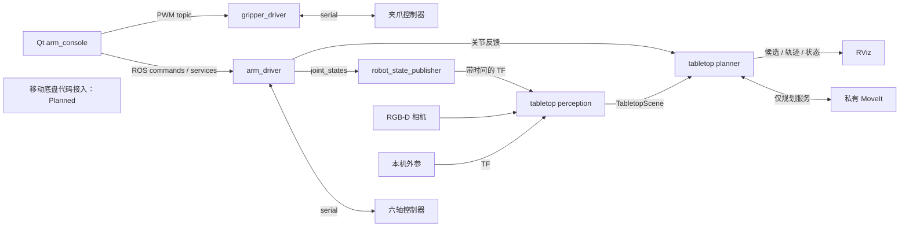

# ROS 2 Visual Manipulation Platform — Toward Mobile Manipulation

## Overview

学生自主开发的 ROS 2 视觉机械臂平台，包含六轴串口控制、二指夹爪、RGB-D 感知与
Qt 操作台，正在向移动视觉操作平台演进。**截至 2026-09-20，当前仓库没有移动底盘
驱动、里程计或导航集成代码，不能复现 autonomous mobile manipulation。**
底盘实物已加入系统（用户确认）；限定开发目录未找到其控制实现，详见 [Mobile Base](docs/mobile_base.md)。

面向真实六轴机械臂的 ROS 2 Humble 工作区，包含串口驱动、独立夹爪控制、Qt 操作台、
机器人描述、RGB-D 感知、相机标定和 MoveIt 规划。项目以 Python 与 ROS 消息接口为主，
用于理解系统、开展分层验证，以及在完成本机标定和安全检查后进行受监督的硬件实验。

**当前视觉抓取入口只做感知与路径规划，不执行抓取。** 原创软件采用 Apache-2.0。
公开候选排除了许可尚未确认的 CAD/STL、URDF/SRDF、派生夹爪几何和现场标定数据；
Internal CAD-derived geometry validation is excluded from the public software release.
因此它能复现文中标明的软件子集，尚不是完整的机械臂硬件复现套件。
本地开发树保留原模型，不代表这些资产已经获得再分发许可。详见
[本次审计](docs/audit_2026-09-20.md)、[历史发布报告](docs/RELEASE_READINESS.md)、[发布审计](PUBLICATION_AUDIT.md)和
[第三方材料说明](THIRD_PARTY_NOTICES.md)。

默认启动不接执行器：机械臂 `use_mock=true` 且 `allow_motion_commands=false`；
夹爪 `allow_hardware_actuation=false`。真实使用必须显式启用各自权限。
当前发布候选与验收边界见 [RELEASE_CHECKLIST.md](RELEASE_CHECKLIST.md)。

## Demo

当前没有获准公开的实机照片、录像或 GIF。素材要求见 [docs/media](docs/media/README.md)。
下文的合成几何与 mock 示例是软件演示，不代表真实抓取、底盘运动或整机验收。

## Features

- ✅ Working（已有实现）：六轴串口控制/反馈、手动 GUI、夹爪协议、相机工具和离线几何测试。
- 🚧 Experimental / WIP：RGB-D 实物几何、手眼/TCP 标定、MoveIt 抓取路径规划和故障恢复。
- 📋 Planned：底盘代码接入、整机 TF、里程计、停稳互锁、导航与移动操作流程。

“已有实现”表示源码和软件验证范围，真实硬件验收仍需逐项独立完成。

| 部分 | 当前能力 | 验证边界 |
| --- | --- | --- |
| 六轴驱动 | raw/ideal 角度映射、位置反馈、普通 MOVE、LIVE FOLLOW、STOP/DISABLE、串口重连 | 协议 ACK 不等于到位；固件与实物限位仍需独立验证 |
| Qt 操作台 | 关节反馈与目标、模型预览、手动运动入口、夹爪操作、相机面板 | GUI 通过 ROS 通信，不直接访问串口；PREVIEW ONLY 不约束其他 ROS 节点 |
| 夹爪 | 独立串口 PWM 命令与 ACK | 无位置/力反馈、无 mock 模式；不能从命令证明夹住物体 |
| 相机与标定 | D405 启动/健康检查，Astra 旧视觉工具，固定外参与手眼采样/求解 | 他人的标定不能直接用于本机；TF 连通不等于精度达标 |
| 桌面几何感知 | RGB-D/点云同步与过滤、支撑面、物体分割、尺寸/方向与诊断 | 部分遮挡下的完整尺寸未获保证；近正方形方向可能不可观测 |
| MoveIt | 候选抓取、碰撞检查、预抓取/接近/空手撤退路径 | 仅 dry-run；没有闭爪、带物抬升、任务执行或自动回程 |
| 无硬件运行 | 基础包测试、纯数值几何；有合法模型时可运行合成规划 | 没有完整动力学仿真或硬件数字孪生 |

## 系统架构



手动控制与视觉规划具有不同入口。新 planner 没有机械臂/夹爪命令发布器，
私有 MoveIt 关闭轨迹执行。相机坐标观察模式不依赖机械臂 TF，输出位于
`/tabletop_camera`，不进入基座抓取规划。详细数据流见 [architecture.md](docs/architecture.md)。

## 仓库结构

ROS 包保持各自的 `launch/`、`config/`、测试和安装规则，避免移动资源后破坏
`package://` 与 ament 查找。根目录提供统一文档、示例配置和构建入口。

| ROS 2 package | 职责 |
| --- | --- |
| `arm_driver` | 六轴串口的唯一所有者，映射、反馈、MOVE/LIVE 与停机协议 |
| `gripper_driver` | 夹爪串口与 PWM；历史脉宽到 TCP 伸长插值工具 |
| `arm_console` | Qt GUI、ROS bridge、独立预览和相机显示 |
| `arm_description` | 机器人 URDF、mesh、robot_state_publisher 与 RViz 入口；公开模型尚缺 |
| `camera_perception` | Astra 监视、AprilTag 定位、固定相机外参和点变换工具 |
| `wrist_camera_bringup` | 组合上游 RealSense 驱动，D405 健康检查与 smoke test |
| `dual_camera_foundation` | 总启动、目标点/姿态变换、双相机与手眼标定工具、历史兼容入口 |
| `tabletop_grasp_interfaces` | `OrientedObject` 与 `TabletopScene` 消息 |
| `tabletop_grasp` | 新 RGB-D/Open3D 感知、抓取几何、MoveIt dry-run 与离线几何工具 |

| 根目录 | 用途 |
| --- | --- |
| `scripts/` | 环境、独立构建、测试、结构检查和纯数值 demo |
| [`config/`](config/README.md) | 可复制的参数示例；本机数据存被忽略的 `config/local/` |
| [`models/`](models/README.md) | 模型预期位置、来源与许可边界，不重复复制 package 资源 |
| `docs/` | 安装、架构、硬件、标定、运行与发布报告 |
| [`assets/`](assets/README.md) | 展示材料要求与 TODO；当前无获准公开的演示素材 |
| `tools/release/` | 公开候选的逐文件清单、导出与安全扫描 |

本地树还可能有旧脚本、现场笔记和诊断材料。保留不代表推荐使用，且并非都会进入
公开候选；整理取舍见 [repository_audit.md](docs/repository_audit.md)。

## 软件与硬件

目标环境为 Ubuntu 22.04、ROS 2 Humble、系统 ABI 兼容的 Python 3.10、colcon、
MoveIt 2、tf2、RViz、PyQt5、OpenCV、Open3D、NumPy、SciPy、PyYAML 与 pyserial。
Astra 和 RealSense 的上游驱动分别安装，仓库不携带 vendor 工作区。
依赖版本、安装命令及环境隔离见 [installation.md](docs/installation.md)。

硬件侧包括六轴机械臂及串口控制器、独立 ESP32/PCA9685 夹爪控制器、PWM 夹爪、
腕部 RealSense D405，以及可选的固定 Astra RGB-D 相机。完整 BOM、控制器固件来源、
供电/接线和机械参数仍有缺项，见 [hardware.md](docs/hardware.md)。
软件中的轴方向、零位、限位与夹爪参数只代表当前装配约定，不能直接迁移到其他机械臂。

## Installation & Build

项目仓库：[ros2-visual-manipulator](https://github.com/chao142857/ros2-visual-manipulator)。
当前为软件候选的 private staging；访问权限和远程 CI 状态见 [RELEASE_CHECKLIST.md](RELEASE_CHECKLIST.md)。

```bash
git clone https://github.com/chao142857/ros2-visual-manipulator
cd ros2-visual-manipulator
source /opt/ros/humble/setup.bash
rosdep install --from-paths src --ignore-src --rosdistro humble -r -y \
  --skip-keys 'astra_camera python3-open3d'
```

先按 [安装文档](docs/installation.md) 安装 ROS 并初始化 rosdep。跳过的 Astra 是可选厂商
驱动，Open3D 在文档指定的 ROS 兼容虚拟环境中安装；跳过不代表该依赖已经满足。

先完成 [安装文档](docs/installation.md) 的 ROS、系统库和本地 Python 环境准备。
下面的命令从仓库根目录运行；下载后目录可自行命名，不要求固定用户目录或相邻 vendor 路径。
构建使用新的终端，不预先 source 旧应用 overlay。

```bash
# 使用安装文档创建的 Python 3.10 环境；不修改系统 Python
export PYTHONNOUSERSITE=1
export ARM_PYTHON_ENV="$PWD/.venv"

# 公开候选可运行的基础包构建与功能测试
bash scripts/ci.sh
```

CI 子集包括 `arm_driver`、`gripper_driver` 和 `camera_perception`。
它不是完整项目、MoveIt 或实体硬件验收。具备所需依赖和合法模型的完整本地开发树可执行：

```bash
bash scripts/build.sh
source scripts/env.sh
bash scripts/test.sh functional
# 全部包测试（包含现有样式检查）
bash scripts/test.sh all
```

新入口将产物写入 `build-release/`、`install-release/`、`log-release/`。
功能测试与样式检查的实际结果、未通过项及验证环境记录在
[本次审计报告](docs/audit_2026-09-20.md)，不使用安装成功代替测试结果。

## 配置

```bash
mkdir -p config/local
cp -n config/examples/arm.feedback.yaml config/local/arm.yaml
cp -n config/examples/gripper.example.yaml config/local/gripper.yaml
```

`cp -n` 保留已有本机配置。按设备确认后编辑本机配置，串口优先使用稳定的 `/dev/serial/by-id/…` 标识。
相机串号、标定结果、ROI、topic/frame 和运行参数的归属见
[configuration.md](docs/configuration.md)。示例标定保持未验证；不能通过修改验证开关
绕过测量。大部分参数在启动时读取，更改后应受控重启，不能假定在线设置已生效。

## Quick Start

每个入口的前提和完整检查步骤见 [bringup.md](docs/bringup.md)。先软件、再相机、
再实体只读反馈与标定，最后才进行明确授权、受监督的手动运动。

### Simulation / Mock：六轴 mock 反馈

基础包构建完成后，在独立测试域运行：

```bash
source scripts/env.sh
export ROS_DOMAIN_ID=192 ROS_LOCALHOST_ONLY=1
ros2 run arm_driver arm_driver_node --ros-args \
  --params-file "$PWD/config/examples/arm.mock.yaml"
```

此例不打开串口，且禁止运动命令。`use_mock` 不是完整运动仿真：普通 MOVE 的 mock
只打印命令，不模拟到位。夹爪默认 disabled，不打开串口、不接收 PWM；这不是位置或夹持仿真。

### 无硬件、无需模型：纯数值几何

安装视觉 Python 依赖后，在未加载应用 overlay 的新终端构建并运行：

```bash
export ARM_PYTHON_ENV="$PWD/.venv"
bash scripts/build.sh --packages-select tabletop_grasp_interfaces tabletop_grasp \
  --packages-ignore arm_description arm_console wrist_camera_bringup
source scripts/env.sh
python3 scripts/demo_geometry.py
```

脚本处理合成立方体点云并输出尺寸和候选数量，不创建 ROS 节点、不连接设备。
忽略的包仅用于此处未运行的硬件/模型集成；这不是完整 bringup 构建。
它检验几何计算，不证明 CAD 尺寸、实物外参、遮挡完整性或抓取成功。

### 有合法模型、无硬件：MoveIt 合成规划

仅适用于已按 [模型说明](models/README.md) 提供匹配 URDF、mesh 与 SRDF 的开发树：

```bash
source scripts/env.sh
export ROS_DOMAIN_ID=191 ROS_LOCALHOST_ONLY=1
ros2 launch tabletop_grasp synthetic_demo.launch.py rviz:=false
```

有图形环境时可用 `rviz:=true`。此入口要求域 191，使用专用测试关节反馈与合成场景。
不包含物理动力学、夹持接触或硬件执行。公开候选缺少模型时不要运行此命令。

### 仅相机：D405 坐标系观察

完成上游 RealSense 安装，确认 SDK 串号并设置 `CAMERA_SERIAL` 后运行：

```bash
source scripts/env.sh
ros2 launch tabletop_grasp camera_observation.launch.py \
  camera_serial:="${CAMERA_SERIAL:?填写本机 SDK 串号}" rviz:=true
```

此入口打开相机，不启动机械臂驱动、robot_state_publisher、外参或 MoveIt。
输出 `/tabletop_camera/*` 是相机坐标几何；方向箭头不是可执行 TCP 目标。

### Real Robot：反馈、标定与受监督控制

> **WARNING — 真实硬件：** 以下入口会打开串口。本次审计没有执行它们。先确认独立急停、
> 工作空间、逐轴限位、碰撞风险、设备身份和底盘净空；软件 STOP 不能代替硬件急停。

先阅读 [安全说明](docs/safety.md)。编辑好的 `config/local/arm.yaml` 必须保留
`use_mock: false`、`allow_motion_commands: false`，并填写已确认的实体串口：

```bash
source scripts/env.sh
ros2 run arm_driver arm_driver_node --ros-args \
  --params-file "$PWD/config/local/arm.yaml" \
  -p use_mock:=false -p allow_motion_commands:=false
```

这是实体反馈入口，会打开串口并轮询，但禁止该驱动接受 START/MOVE；STOP/DISABLE
服务仍可写串口，因此它不是完全无写入或本次审计可以运行的离线入口。
随后按 [bringup.md](docs/bringup.md) 核对方向、参考角、停机手段、命令所有者和
[calibration.md](docs/calibration.md) 的 TCP/相机外参。手动运动、夹爪 test 与基座
规划使用其中各自的启动步骤。根 README 不提供自动运动或自动抓取的一键入口。

显式恢复原有实体控制（**允许接收来自同域其他节点的动作请求**，不是离线测试）：

```bash
ros2 run arm_driver arm_driver_node --ros-args \
  --params-file "$PWD/config/local/arm.yaml" \
  -p use_mock:=false -p allow_motion_commands:=true
# 夹爪是独立权限；先停止同串口的其他驱动
ros2 run gripper_driver gripper_driver_node --ros-args \
  --params-file "$PWD/config/local/gripper.yaml" -p allow_hardware_actuation:=true
```

这里只启用原控制入口，不发送目标。START/MOVE、LIVE 和夹爪 PWM 仍需受监督操作。
launch 对应参数为 `arm_allow_motion_commands`、`gripper_allow_hardware_actuation`；
arm mock 参数在 Console 为 `use_mock`，canonical bringup 为 `arm_use_mock`。

## ROS 接口与坐标系

| 接口 | 类型 / 作用 |
| --- | --- |
| `/joint_states`、`/arm/raw_joint_states` | `sensor_msgs/JointState`；ideal/raw 角度，单位 rad |
| `/arm/joint_command`、`/arm/live_joint_command` | 六个命名关节目标；普通 MOVE 与 LIVE 路径 |
| `/arm/stop`、`/arm/disable` | `std_srvs/Trigger`；软件协议停机/卸力 |
| `/gripper/pulse_us` | `std_msgs/Int32`；夹爪 PWM 命令，单位 μs |
| `/tabletop/scene` | `TabletopScene`；一个采集时间对应的桌面与物体几何 |
| `/tabletop/replan` | `std_srvs/Trigger`；重新请求 dry-run 规划 |
| `/tabletop/planner_status`、`/tabletop/display_planned_path` | 规划状态与 RViz 轨迹显示 |
| `/tabletop_camera/*` | 隔离的相机坐标观测、点云、诊断与方向预览 |

主链为 `base_link → joint1…joint6 对应 links → tool0 → tcp`；
`tcp_extension_joint` 是被动伸长，不是第七个受控轴。腕部相机通过本机标定的
`tool0 → wrist_d405_link` 接入，再由相机驱动提供内部 optical frame。
固定相机需要独立基座外参。frame 无前导 `/`，optical frame 使用相机光学坐标约定。
节点、服务和 TF 详情见 [architecture.md](docs/architecture.md)。

## Mobile Base

当前 9 个包没有底盘 driver、`cmd_vel`、`nav_msgs/Odometry`、wheel feedback、Nav2 或
统一底盘/机械臂 TF。**Mobile base integration is currently under development; its driver
code is not present in this repository.** 也不能据此声称两个 subsystem 已可分别运行。
已有 `base_link` 表示机械臂根，不能直接改作底盘根；接入顺序和资料缺口见
[mobile_base.md](docs/mobile_base.md)。没有添加虚假的 `base.launch.py` 或自动整机启动。

## Visual Grasping

新 pipeline 是 RGB-D/PointCloud2 → 带时间的坐标变换 → ROI/降采样/离群过滤 →
支撑面 RANSAC → 聚类/OBB → 候选抓取 → 几何验证 → 碰撞场景/IK → OMPL 预抓取
与 Cartesian 接近/空手撤退。`dry_run=false` 会被拒绝；`READY_TO_EXECUTE`
只是保留的状态名，不表示允许运动。详见 [vision.md](docs/vision.md)。

AprilTag、固定相机和手眼工具作为独立标定/历史工具保留。旧 `visual_grasp` 可执行名
已指向新 planner，不能继续套用旧点击抓取参数或把旧包装脚本作为已验证 demo。

夹爪当前 OPEN 预设为 **600 μs**，CLOSE/抓物预设为 **1300 μs**，允许区间为
**600–1700 μs**，默认时间 600 ms。上限不等于 CLOSE 预设，脉宽也不等于开口反馈。
历史 PWM→TCP 插值与当前 CAD 估计需要分别核实，详见 [hardware.md](docs/hardware.md)。

## Calibration

相机内参/畸变、固定相机外参、腕部手眼外参、夹爪开口与 `tool0 → tcp` 必须分别验证。
本地 YAML 的拟合误差和 `calibrated` 字段不能证明当前安装精度；默认抓取验证门禁仍有
未完成项。真实反馈只发布六个臂关节，尚缺被动 `tcp_extension_joint` 的常规状态来源，
不能假定 RSP 会自动生成 TCP TF。详见 [calibration.md](docs/calibration.md)。

## Known Issues & Limitations

- 已修复裸驱动危险默认；显式 opt-in 后仍需独立急停、命令源管理和实物验收。
- 夹爪新增硬件许可门，但没有位置/力反馈或完整故障恢复；普通 MOVE ACK 不是到位结果。
- TCP 状态来源缺失、多圈 J6 编辑范围、普通命令时间戳门禁仍需独立修复。
- 旧 Astra click-grasp wrapper 与新 planner 的 topic/参数不兼容，不能作为可用抓取入口。
- 模型/标定依赖本机资产，完整模型许可、固件、BOM、冷安装复现和底盘代码尚未齐备。

风险分级、证据、处理边界见 [known_issues.md](docs/known_issues.md)。本次构建和测试结果
见 [审计报告](docs/audit_2026-09-20.md)，历史测试数字不作为当前验收结果。

## Safety

- 裸臂驱动默认 `use_mock=true`、`allow_motion_commands=false`；夹爪默认禁用硬件。
  `arm_feedback_safe` 固定禁止 START/MOVE；真机反馈模式仍可执行 STOP/DISABLE，非完全只读。
- 不改变关节方向、零位、映射、速度、限位或 PWM 范围来消除报错或让规划通过。
  J6 的 continuous 模型不证明线缆和机械结构允许无限旋转。
- STOP/DISABLE 是主机串口协议，不是独立硬件急停。失联、掉电或进程崩溃时不能
  保证软件停机送达；DISABLE 可能使机械臂或负载下坠。
- 相机、mock、ROS 网络和 GUI 的状态不构成系统级运动授权。每个控制器应只有一个
  串口所有者；隔离测试域，不与实体驱动混用模拟反馈。
- 当前没有完整固件/BOM 发布、实测惯量/负载模型、可靠的夹爪反馈或完整抓取执行
  生命周期。GUI 多圈 J6 编辑、普通 MOVE 到位确认等技术债尚在。

全部边界见 [safety.md](docs/safety.md)；硬件契约与整理改动单独记在
[hardware_changes.md](docs/hardware_changes.md)。

## Documentation & Roadmap

| 文档 | 内容 |
| --- | --- |
| [installation.md](docs/installation.md) / [bringup.md](docs/bringup.md) | 安装、构建、demo 与实体启动顺序 |
| [architecture.md](docs/architecture.md) / [hardware.md](docs/hardware.md) | 包、节点、TF、协议与装配 |
| [configuration.md](docs/configuration.md) / [calibration.md](docs/calibration.md) | 参数、设备选择、TCP 与相机标定 |
| [vision.md](docs/vision.md) / [troubleshooting.md](docs/troubleshooting.md) | 感知/规划边界与故障定位 |
| [mobile_base.md](docs/mobile_base.md) | 底盘未接入现状、TF 合同与接入前置条件 |
| [known_issues.md](docs/known_issues.md) / [roadmap.md](docs/roadmap.md) | 分级问题、Experimental/WIP 与验收条件 |
| [audit_2026-09-20.md](docs/audit_2026-09-20.md) | 本次改动、测试证据与逐项 GitHub readiness |

展示 TODO：获准公开的整机照片、接线图、合法模型的规划录像和受监督硬件录像。
当前没有可公开展示的演示素材，不把合成结果标为实机演示。

下一阶段优先完成：

1. 确认模型/原创 CAD 的授权与来源，让完整机器人模型可合法复现。
2. 补齐硬件 BOM、固件版本、协议与供电/停机接线。
3. 建立可重复的每轴、TCP、夹爪开口及手眼外参实测验收。
4. 单独设计运动所有权、执行/到位/中止状态与带物碰撞模型，再讨论自动抓取。
5. 补充可公开的视觉测试数据、遮挡/失败案例与持续集成证据。

底盘接入与整机互锁按 [结构化 Roadmap](docs/roadmap.md) 推进；Nav2、带物抓取执行和
完整移动操作属于后续计划，不是已实现 Features。

欢迎通过 [贡献指南](CONTRIBUTING.md) 提交可审查的小改动。
项目仓库：[ros2-visual-manipulator](https://github.com/chao142857/ros2-visual-manipulator)。
公开维护邮箱：`chao070503@gmail.com`。

## License

原创软件许可见 [LICENSE](LICENSE)，第三方和硬件资产以各自授权为准。
仓库已有 Apache-2.0 文本，本次没有重新选许可证。公开候选的九包均声明 Apache-2.0；
`arm_description` 仅包含已审查软件和说明文件。本地模型许可仍未闭合，
不进入公开候选，也不受根软件许可证自动覆盖。
