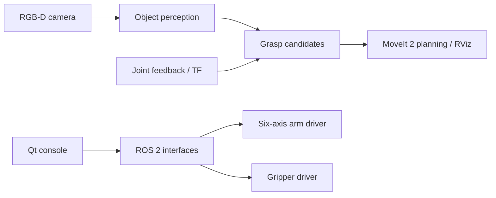

# ROS 2 Visual Manipulator

**English** | [简体中文](README_CN.md)

A ROS 2 workspace for a six-axis robotic arm with serial control, an independent two-finger gripper, RGB-D perception, and a Qt control interface. The project brings together low-level robot communication, visual object localization, coordinate transforms, and grasp planning in a modular system.

Built as a hands-on robotics project on **Ubuntu 22.04 + ROS 2 Humble**.

## Features

- **Robot control:** six-axis serial communication, joint-state feedback, joint commands, and ROS 2 command topics and services.
- **Operator interface:** a Qt desktop console for joint monitoring, manual control, camera views, and robot visualization.
- **RGB-D perception:** Intel RealSense D405 and optional Astra camera integration, AprilTag-based localization, camera calibration, and TF transforms.
- **Tabletop object detection:** point-cloud filtering, plane segmentation, object clustering, and oriented bounding-box estimation with Open3D.
- **Grasp planning:** candidate grasp generation, inverse kinematics, collision checking, and MoveIt 2 trajectory planning and visualization.

The arm and gripper can be operated through ROS 2 interfaces. The newer tabletop grasp pipeline currently focuses on **perception and motion planning** rather than autonomous execution of the entire grasp-and-place sequence.

## System overview



## Getting started

### Requirements

- Ubuntu 22.04, ROS 2 Humble, Python 3.10
- `colcon`, `rosdep`, and the project's Python dependencies
- Optional for the full visual pipeline: MoveIt 2, Open3D, OpenCV, and a compatible RGB-D camera driver

See [installation.md](docs/installation.md) for dependency setup, including the recommended Python environment.

```bash
git clone https://github.com/chao142857/ros2-visual-manipulator.git
cd ros2-visual-manipulator
source /opt/ros/humble/setup.bash

# Build and test the software-only core packages
bash scripts/ci.sh
```

### Run the arm driver in mock mode

After building the core packages:

```bash
source scripts/env.sh
ros2 run arm_driver arm_driver_node --ros-args \
  --params-file "$PWD/config/examples/arm.mock.yaml"
```

This starts the ROS 2 driver with simulated joint feedback, without connecting to the robot.

### Try the tabletop geometry pipeline

After installing the vision dependencies and configuring the Python environment described in [installation.md](docs/installation.md), run the following in a new terminal with no application overlay sourced:

```bash
export ARM_PYTHON_ENV="$PWD/.venv"
bash scripts/build.sh --packages-select tabletop_grasp_interfaces tabletop_grasp \
  --packages-ignore arm_description arm_console wrist_camera_bringup
source scripts/env.sh
python3 scripts/demo_geometry.py
```

The demo processes a synthetic point cloud and prints object dimensions and the grasp candidate count. For camera setup, robot bringup, GUI usage, and MoveIt visualization, see [bringup.md](docs/bringup.md).

## Repository structure

| Package | Purpose |
| --- | --- |
| `arm_driver` | Six-axis serial communication, commands, and feedback |
| `gripper_driver` | Independent gripper control |
| `arm_console` | Qt operator interface and visualization |
| `arm_description` | Robot description, TF, and RViz integration |
| `camera_perception` | Camera utilities and AprilTag localization |
| `wrist_camera_bringup` | RealSense D405 setup |
| `dual_camera_foundation` | Multi-camera integration and calibration tools |
| `tabletop_grasp_interfaces` | Custom ROS 2 messages for tabletop scenes |
| `tabletop_grasp` | RGB-D perception, grasp generation, and MoveIt planning |

## Documentation

- [Installation and dependencies](docs/installation.md)
- [System architecture and ROS interfaces](docs/architecture.md)
- [Launch instructions](docs/bringup.md)
- [Vision and grasp planning](docs/vision.md)
- [Camera and robot calibration](docs/calibration.md)
- [Hardware setup](docs/hardware.md)

## Notes

The public repository focuses on software and development tools. Some robot CAD/mesh files and machine-specific calibration data are not distributed, so full robot-model visualization and hardware setup require the corresponding assets and local configuration. See [models/README.md](models/README.md) for details.

This is an ongoing personal robotics project. Contributions and suggestions are welcome via [issues](https://github.com/chao142857/ros2-visual-manipulator/issues) and [pull requests](CONTRIBUTING.md).

## License

The original software is released under [Apache License 2.0](LICENSE). Third-party components and hardware assets retain their own licenses; see [third-party notices](THIRD_PARTY_NOTICES.md).
