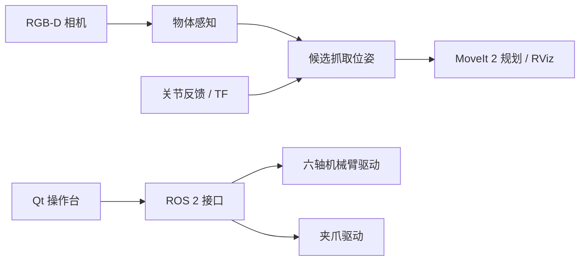

# ROS 2 Visual Manipulator｜ROS 2 视觉机械臂

[English](README.md) | **简体中文**

基于 **Ubuntu 22.04 + ROS 2 Humble** 开发的六轴视觉机械臂项目，集成串口运动控制、独立二指夹爪、RGB-D 视觉感知和 Qt 操作界面。项目涵盖从关节状态反馈、目标定位、坐标变换到抓取位姿生成与运动规划的完整软件开发流程。

## 主要功能

- **机械臂控制：** 六轴串口通信、关节状态反馈、关节指令下发及 ROS 2 指令话题与服务。
- **可视化操作：** 基于 Qt 的上位机，支持关节监控、手动控制、相机画面与机器人可视化。
- **RGB-D 感知：** 支持 Intel RealSense D405，并保留 Astra 相机接入、AprilTag 定位、相机标定和 TF 坐标变换工具。
- **桌面物体识别：** 基于 Open3D 实现点云滤波、平面分割、物体聚类与三维包围盒估计。
- **抓取规划：** 生成候选抓取位姿，结合逆运动学、碰撞检测和 MoveIt 2 进行轨迹规划与可视化。

机械臂与夹爪具有独立的 ROS 2 控制接口；目前新的桌面抓取流程主要实现了**视觉感知与运动规划**，尚未将整套自动抓取与放置动作集成为一键执行流程。

## 系统结构



## 快速开始

### 环境要求

- Ubuntu 22.04、ROS 2 Humble、Python 3.10
- `colcon`、`rosdep` 及项目所需 Python 依赖
- 完整视觉流程另外使用 MoveIt 2、Open3D、OpenCV 和对应 RGB-D 相机驱动

依赖和 Python 环境配置详见 [安装文档](docs/installation.md)。

```bash
git clone https://github.com/chao142857/ros2-visual-manipulator.git
cd ros2-visual-manipulator
source /opt/ros/humble/setup.bash

# 构建并测试不依赖实物模型的核心软件包
bash scripts/ci.sh
```

### 启动机械臂 Mock 节点

完成核心软件包构建后运行：

```bash
source scripts/env.sh
ros2 run arm_driver arm_driver_node --ros-args \
  --params-file "$PWD/config/examples/arm.mock.yaml"
```

该模式使用模拟关节反馈，不需要连接真实机械臂。

### 运行桌面物体几何示例

先按 [安装文档](docs/installation.md) 配置视觉依赖及 Python 虚拟环境，再在未加载应用 overlay 的新终端中执行：

```bash
export ARM_PYTHON_ENV="$PWD/.venv"
bash scripts/build.sh --packages-select tabletop_grasp_interfaces tabletop_grasp \
  --packages-ignore arm_description arm_console wrist_camera_bringup
source scripts/env.sh
python3 scripts/demo_geometry.py
```

示例使用合成点云计算物体尺寸、生成候选抓取位姿并输出候选数量，不需要连接硬件。真实相机、机械臂启动、GUI 和 MoveIt 可视化的使用方式见 [启动文档](docs/bringup.md)。

## 项目结构

| ROS 2 功能包 | 主要职责 |
| --- | --- |
| `arm_driver` | 六轴串口通信、运动指令与关节反馈 |
| `gripper_driver` | 独立夹爪控制 |
| `arm_console` | Qt 上位机与可视化界面 |
| `arm_description` | 机器人模型、TF 与 RViz |
| `camera_perception` | 相机工具与 AprilTag 定位 |
| `wrist_camera_bringup` | RealSense D405 相机启动 |
| `dual_camera_foundation` | 多相机集成与标定工具 |
| `tabletop_grasp_interfaces` | 桌面场景的自定义 ROS 2 消息 |
| `tabletop_grasp` | RGB-D 感知、抓取位姿生成与 MoveIt 规划 |

## 相关文档

- [安装与依赖](docs/installation.md)
- [系统架构与 ROS 接口](docs/architecture.md)
- [系统启动与使用](docs/bringup.md)
- [视觉感知与抓取规划](docs/vision.md)
- [相机与机械臂标定](docs/calibration.md)
- [硬件说明](docs/hardware.md)

## 说明

本仓库主要公开项目的软件实现和开发工具。部分机器人 CAD / mesh 模型及设备专用标定数据未随仓库提供，因此完整的机器人模型显示和真机运行需要补充对应模型与本机配置。具体可参考 [模型说明](models/README.md)。

这是一个持续迭代中的个人机器人项目，欢迎通过 [Issues](https://github.com/chao142857/ros2-visual-manipulator/issues) 交流或提交 [Pull Request](CONTRIBUTING.md)。

## 开源协议

原创软件基于 [Apache License 2.0](LICENSE) 开源。第三方依赖和硬件资产使用各自的许可证，详见 [第三方说明](THIRD_PARTY_NOTICES.md)。
