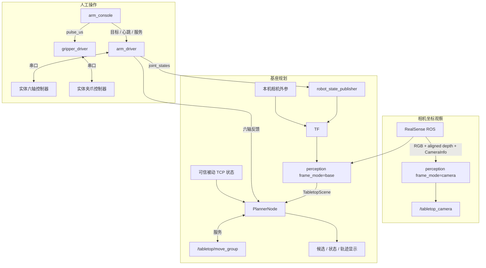
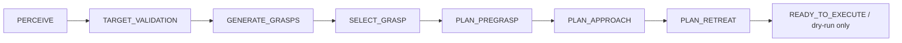
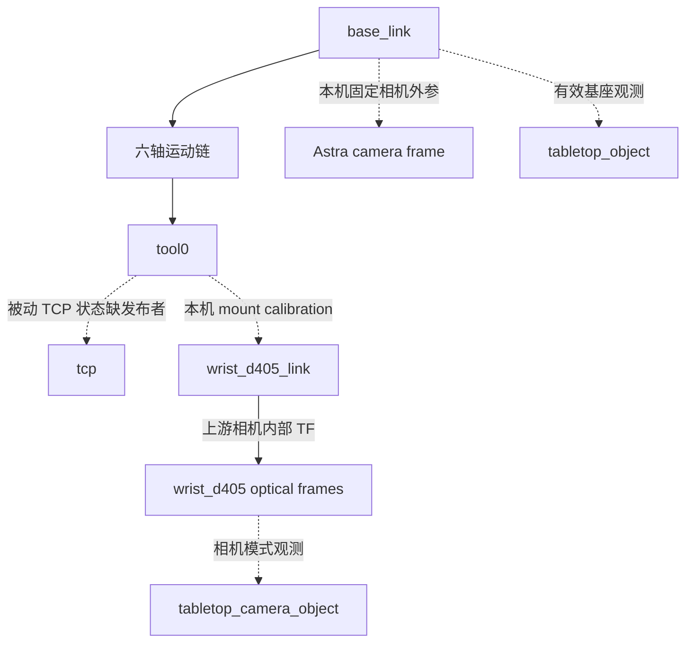

# 系统架构

本工作区由九个 ROS 2 package 构成。ROS 接口连接上层 GUI/感知与底层串口驱动；
当前推荐的视觉入口只生成候选与路径。包存在或 launch 可解析，不表示对应硬件、
模型、标定或固件已经随公开仓库提供。

2026-09-20 审计范围：以下 ROS graph 由当前 `src/` 的节点、entry point、launch、
消息及模型静态重建，没有启动实体节点采集运行图，也没有验证硬件动作。本轮未发现
移动底盘 package、`cmd_vel` 控制、里程计、轮关节模型或 Nav2 集成；下图中的
`base_link` 是机械臂模型基座，不代表移动底盘。平台正向 mobile manipulation 演进，
当前仓库尚不能证明底盘子系统已经集成。

## 包与资源所有权

| 层 | 包 | 职责与边界 |
| --- | --- | --- |
| 协议/驱动 | `arm_driver` | 串口连接、raw/ideal 映射、反馈、MOVE、LIVE、停机与重连 |
| 协议/驱动 | `gripper_driver` | 独立串口 PWM；不负责机械臂动作或抓取状态机 |
| 操作界面 | `arm_console` | Qt 主线程与 ROS bridge、关节/相机显示、预览、命令路由 |
| 机器人描述 | `arm_description` | URDF/mesh、robot_state_publisher、RViz；无完整动力学仿真 |
| 旧感知/标定 | `camera_perception` | Astra RGB-D、AprilTag、固定相机外参、目标点工具 |
| 相机集成 | `wrist_camera_bringup` | 调用上游 RealSense launch，配置 D405，检查流与健康 |
| 编排/标定 | `dual_camera_foundation` | 总启动、双相机变换、手眼/安装标定与历史兼容入口 |
| 消息 | `tabletop_grasp_interfaces` | 独立定义场景与物体消息 |
| 新感知/规划 | `tabletop_grasp` | Open3D 几何、候选、验证门禁和私有 MoveIt 服务适配 |

`tabletop_grasp_interfaces` 是消息构建依赖；纯数值 demo 虽不启动 ROS，仍需已生成的
Python 消息类型。相机 SDK/ROS wrapper、MoveIt 和 ROS 核心由外部依赖提供。
项目不复制 vendor 实现，也不要求固定的兄弟工作区布局。

各包在自己的 `launch/`、`config/` 中拥有运行资源；根 `config/examples/` 提供现有
接口的用户示例，`scripts/` 提供统一入口，`tools/release/` 负责发布清单和导出。
模型路径和公开候选缺项见 [models/README.md](../models/README.md)。

## 三条运行路径

相机观察不生成基座 TCP 目标。基座 planner 没有硬件执行连接；其 MoveIt 实例的
`allow_trajectory_execution=false`，不管理控制器，并关闭 MoveAction 与
ExecuteTrajectoryAction。当前夹爪驱动也不提供可信的被动 TCP 实测状态，
因此不能仅凭六轴反馈和一张图像就认为基座规划的所有前提已满足。

## 六轴与 GUI 接口

| 接口 | 消息/服务类型 | 发布方 → 使用方 | 约定 |
| --- | --- | --- | --- |
| `/joint_states` | `sensor_msgs/JointState` | arm_driver → GUI/RSP/planner | ideal 角度，rad；需要真实时间与六轴名称 |
| `/arm/raw_joint_states` | `sensor_msgs/JointState` | arm_driver → 诊断 | 原始控制器角度，rad |
| `/arm/joint_command` | `sensor_msgs/JointState` | 操作端 → arm_driver | 普通目标；六个命名关节、有限数值、非零时间戳 |
| `/arm/live_joint_command` | `sensor_msgs/JointState` | 操作端 → arm_driver | LIVE 目标；需已开启 LIVE 与心跳/反馈约束 |
| `/arm/live_follow_heartbeat` | `std_msgs/Header` | 操作端 → arm_driver | LIVE 新鲜度检查 |
| `/arm/live_follow_state` | `std_msgs/Bool` | arm_driver → GUI | 软件 LIVE 状态，不是静止证明 |
| `/arm/live_follow` | `std_srvs/SetBool` | GUI → arm_driver | 显式进入/退出 LIVE |
| `/arm/stop` | `std_srvs/Trigger` | 操作端 → arm_driver | STOP 协议事务 |
| `/arm/disable` | `std_srvs/Trigger` | 操作端 → arm_driver | 卸力协议事务 |
| `/arm/preview_joint_states` | `sensor_msgs/JointState` | GUI → preview RSP | 仅预览，不作为实体反馈 |
| `/gripper/pulse_us` | `std_msgs/Int32` | 操作端 → gripper_driver | μs；夹爪自身的独立命令路径 |

修改命名时同时更新发布/订阅端。普通 MOVE 使用目标 topic，没有提供完整 ROS Action
的接收、开始、到位、取消生命周期。START/MOVE ACK、位置更新和实际到位必须分别理解。
GUI 的模型预览使用独立 `preview/` frame 前缀，不能反馈进入实体控制。协议时序、映射
与限制见 [hardware.md](hardware.md)，停机与失联见 [safety.md](safety.md)。

夹爪驱动启动后发送 `PING`，通过 `PONG ESP32_PCA9685_GRIPPER_V1` 检查控制器；
收到合法脉宽后发送 `SET channel pulse duration` 并检查 `OK SET` 回复。驱动没有发布
夹爪位置、接触、抓取成功或 `JointState` 状态，ACK 仅写入日志。GUI 的夹爪可用状态
来自命令 topic 的订阅者数量，发布成功也不等于动作完成。MCU 固件未随当前源码提供，
不能从 host 协议推断上电 PWM、断连保护或实际夹爪位置。

## 新视觉接口

`tabletop_grasp` 的 `perception_node.py` 拥有输入同步、时间检查、TF 和 ROS 发布；
`pipeline.py` 负责过滤、桌面与物体几何；`grasps.py` 负责候选与夹爪几何门禁；
`controller.py` 管理规划状态与新鲜度；`moveit_adapter.py` 封装 FK/IK/碰撞/路径服务。
数值计算和 ROS 编排已分离，本轮没有重新设计算法接口。

默认 RGB-D 输入：

| 输入 | 类型 |
| --- | --- |
| `/wrist_camera/wrist_d405/color/image_rect_raw` | `sensor_msgs/Image` |
| `/wrist_camera/wrist_d405/aligned_depth_to_color/image_raw` | `sensor_msgs/Image` |
| `/wrist_camera/wrist_d405/color/camera_info` | `sensor_msgs/CameraInfo` |
| `/wrist_camera/wrist_d405/depth/color/points` | 可选 `sensor_msgs/PointCloud2` 路径 |

RGB-D 使用近似时间同步与 SensorDataQoS，校验编码、尺寸、frame、深度单位和输入年龄。
处理前后均检查新鲜度，并只保留最新的待处理输入，避免在高延迟下持续发布旧场景。

| 输出/服务 | 类型 | 含义 |
| --- | --- | --- |
| `/tabletop/scene` | `tabletop_grasp_interfaces/TabletopScene` | 一个观测时刻的桌面与物体 |
| `/tabletop/perception_markers` | `visualization_msgs/MarkerArray` | 几何显示 |
| `/tabletop/{input,filtered,table,target}_cloud` | `sensor_msgs/PointCloud2` | 分层调试点云 |
| `/tabletop/diagnostics` | `diagnostic_msgs/DiagnosticArray` | 新鲜度、几何与验证状态 |
| `/tabletop/grasp_candidates` | `geometry_msgs/PoseArray` | 候选 TCP 姿态 |
| `/tabletop/{selected_grasp,pregrasp,grasp,retreat}` | `geometry_msgs/PoseStamped` | 选中候选及阶段目标 |
| `/tabletop/grasp_markers` | `visualization_msgs/MarkerArray` | 抓取几何显示 |
| `/tabletop/display_planned_path` | `moveit_msgs/DisplayTrajectory` | RViz 轨迹显示 |
| `/tabletop/planner_status` | `std_msgs/String` | JSON 状态/原因，不是执行反馈 |
| `/tabletop/replan` | `std_srvs/Trigger` | 重新规划请求 |

相机模式前缀为 `/tabletop_camera`，另有 `/orientation_preview` 表示短轴的两种方向。
它不运行 planner、不公布“可执行抓取”。正常对象 frame 是 `tabletop_object`，相机模式为
`tabletop_camera_object`；父 frame 来自对应观测。无效场景清空 scene、调试点云和 markers，
并停止目标 TF 更新；tf2 缓存与下游曾收到的 PoseStamped 不会被撤销。planner 中止时清空
候选与显示轨迹，但阶段 PoseStamped 也不是“撤回”消息。下游必须联合检查 `scene.valid`、
采集时间戳和 `planner_status`，不能把上次有效姿态当当前观测继续使用。

`OrientedObject` 的 X/Y/Z 分别为长轴/短轴/支撑面法向，包含 id、pose、dimensions、
point_count、quality、yaw_observable。`quality` 是点数启发值，不是成功概率。
`TabletopScene` 包含统一 header、有效性/原因、桌面、物体列表与 target_index；
消息没有宣称遮挡后的完整外形已被测量。

## MoveIt 规划过程

末态只表示规划结果可展示。`dry_run=false` 被构造函数拒绝，不存在随后自动闭爪或
执行轨迹的步骤。规划前需要连续稳定的新鲜场景、六轴反馈、被动 TCP 状态，以及独立的
CAD 尺寸、开口范围、当前开口、TCP、安装与外参验证。场景/关节过期、未来时间戳或漂移
会中止并清除显示。

私有 `move_group` 位于 `/tabletop`。适配器调用 `apply_planning_scene`、`compute_fk`、
`compute_ik`、`check_state_validity`、`plan_kinematic_path` 和 `compute_cartesian_path`。
SRDF 的 arm 组是 `base_link → tool0` 六个主动轴，KDL IK 不把被动 TCP 作为第七轴。
通过同一个 RobotState 的 FK 将期望 TCP 姿态转换为 tool0 目标。

规划场景使用桌面/对象盒体与已验证的静态张开夹爪 proxy。
预抓取使用 OMPL `RRTConnectkConfigDefault`；接近与撤退使用 CartesianPath，要求完整
fraction 与关节连续性检查。撤退仍是张开夹爪的空手路径，没有附着被抓物体，不能解释为
带物抬升或完整 pick-and-place。更多几何限制见 [vision.md](vision.md)。

## TF 与时间

虚线关系必须由对应配置/节点提供，不能仅凭图示假定运行中存在。
机器人模型关节轴依次为 `−Z, −X, −X, −Y, −X, +Y`；raw/ideal 映射与 URDF joint axis
是不同层的约定，两处不能互相抵消着“修正”。J6 在 V2 模型为 continuous，不代表实物
无限转动。`tool0` 是模型参考，`tcp` 包含历史脉宽关联的被动伸长；末端实际夹取点仍需
实测。数值见 [hardware.md](hardware.md)。

当前真实状态链存在具体缺口：`dummy-v2.urdf` 将 `tool0 → tcp` 定义为非固定
`tcp_extension_joint`，但 `arm_driver` 与 Console preview 只发布六个主动关节，
`gripper_driver` 不发布此被动关节。历史 `visual_grasp_controller.py` 只更新自己的
内部 FK，不为 RSP 提供该状态；合成场景提供的值也不能用于实体反馈。因此单独启动
标准 driver/RSP 或 Console preview 不能保证 `tool0 → tcp` TF 连通。新 planner 的
`JointFeedback` 会等待六轴及被动 TCP 的完整新鲜状态；当前真实运行会缺少这一前提。
后续应明确被动状态的测量或估计来源、时间戳与可信性，再接入 RSP/planner，不能静默
填零或把已发送的脉宽当作已测得的位置。

ROS 关节量为 rad，位置为 m，TF 旋转为归一化四元数；frame 名不带前导 `/`。
相机 optical frame 遵循 X 向右、Y 向下、Z 向前。基座模式使用采集时间查询 tf2，
不能把最新 TF 无条件套到旧图像。`base_tf_available` 只表示连通，
`base_tf_trustworthy` 与实体精度是另外的证据。

同一个 TF 子 frame 应有一个权威发布者。Preview、合成关节状态与实体反馈必须隔离；
合成 demo 强制域 191，统一功能测试使用独立域，且限制 localhost。这些措施避免混用，
不提供对同机同域其他进程的访问控制。

## 总启动与历史边界

`dual_camera_foundation/system_bringup.launch.py` 是现有组合入口；默认不启动臂/夹爪
或相机驱动，可按显式参数启用所需组件。`tabletop_grasp.launch.py` 是完整模型与基座
规划入口，会读取机器人模型并需要本机外参，不能在公开候选缺模型时运行。
`camera_observation.launch.py` 和 `synthetic_demo.launch.py` 分别承载相机观察与合成规划。

旧 AprilTag 定位、hand-eye capture/solve/validate 和 mount TF 工具保留。
`dual_camera_foundation` 的 `visual_grasp` executable 已映射到新 planner，旧控制器参数和
Astra 点击包装流程未形成当前受支持的抓取 demo。维护时应核对实际 entry point，不能
根据旧文件名恢复已停止的硬件执行路径。

本轮保留包边界与核心算法，工程修正和公开候选过滤详见
[repository_audit.md](repository_audit.md)、[hardware_changes.md](hardware_changes.md)
与 [RELEASE_READINESS.md](RELEASE_READINESS.md)。

## 后续包边界建议

当前驱动、描述、GUI 和独立消息包职责明确，保留其 package 名称、安装路径及 ROS
接口。`dual_camera_foundation` 同时承担组合启动、标定与历史实验兼容；未来可在保留
旧 launch 包装入口的前提下，将全系统编排逐步交给 `robot_bringup`。该包应只组合
既有节点，明确各组件开关和 arm mock 参数；夹爪目前没有 mock，不能用一个
`mock_hardware` 参数暗示所有执行器都已隔离。

移动底盘代码接入时再建立或采用其实际 driver/description 包，先确定命令来源、
反馈、里程计及 TF 的唯一发布者。机械臂现有 `base_link` 名称与底盘 frame 的关系、
安装变换和静态/动态 TF 所有权需要结合真实机械安装确定，不能现在凭示意图改轴向
或添加 `map → odom → base_link`。Nav2、底盘和机械臂协同规划均属于后续集成工作。
